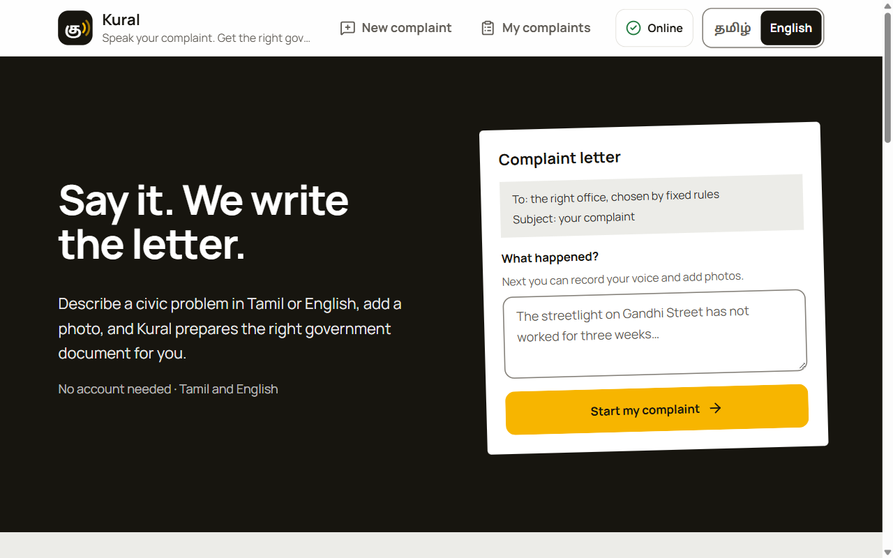
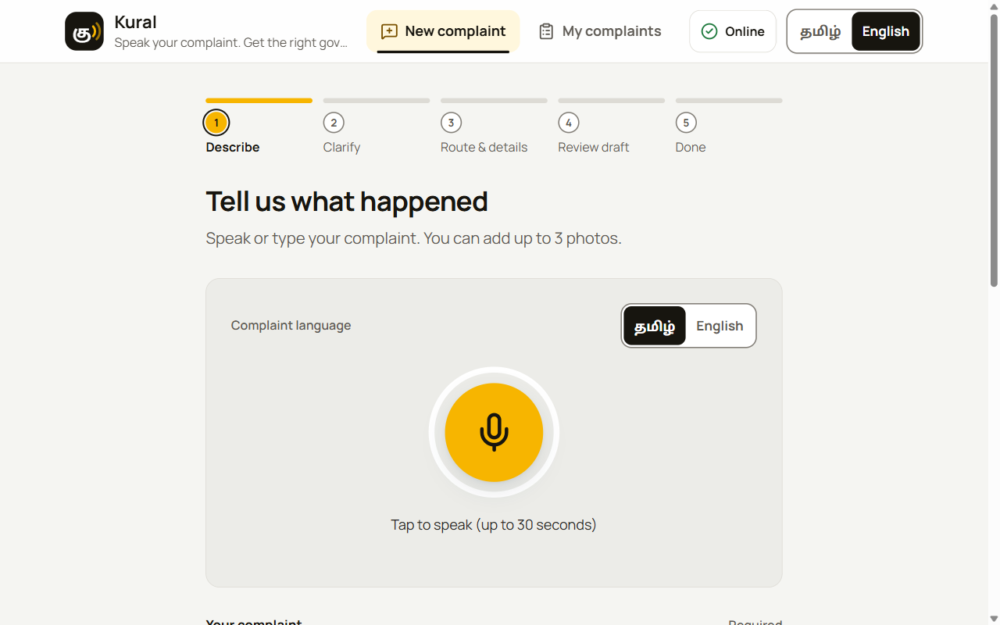
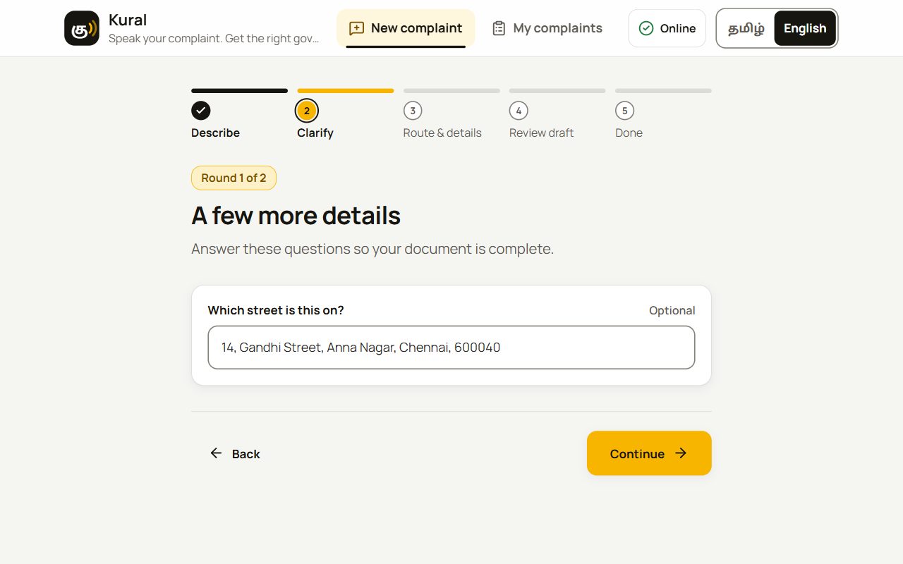
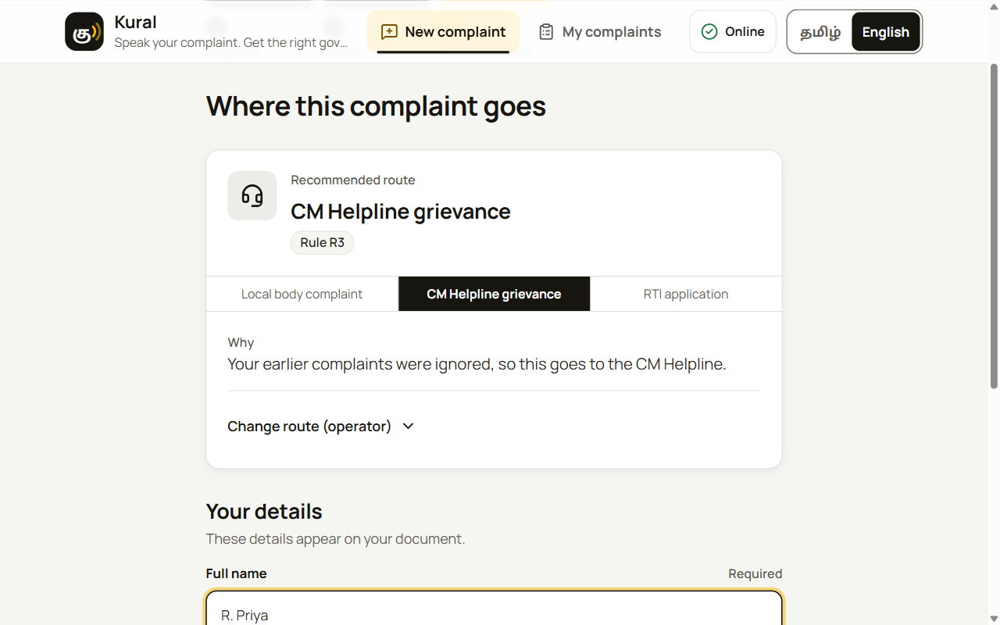
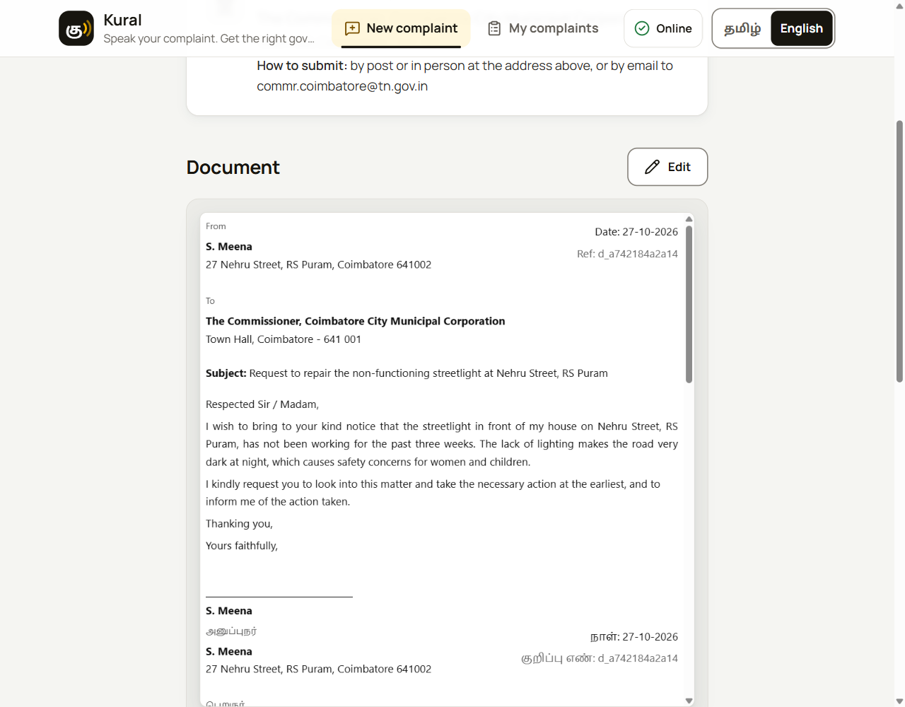
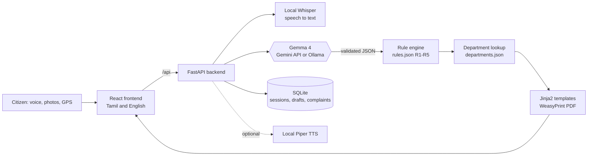

# Kural (குரல்)

[](https://github.com/Spyro007-06/hacktober/actions/workflows/ci.yml)

**Speak your complaint. Get the right government document.**

Kural turns a spoken complaint in Tamil or English, plus a photo, into a ready-to-file bilingual
document for the right office: the local body, the CM Helpline, or an RTI application.
**Gemma 4 reads the complaint and the photo. Fixed rules, not the model, decide where it goes.**
It can run fully offline on a kiosk laptop, so a complaint never has to leave the machine.

Built for the **Best Use of Gemma 4** category in a 12-hour hackathon.



## The problem

People hit civic problems every day (a dead streetlight, a broken road, uncollected garbage) but do not
know which office to contact, which form to use, or how to word it. Complaints in the wrong format are
ignored, and the existing AI tools only draft RTI applications and send everything to the cloud.
Kural is built for residents who prefer Tamil, including elderly and less confident users helped by an
operator at a kiosk (for example an e-Sevai centre).

## How it works

1. **Say it.** Record up to 30 seconds in Tamil or English (or type), and add up to three photos.
   The browser can also supply the GPS position, which is turned into an address.
2. **Gemma 4 understands it.** It extracts structured fields (category, location, duration, severity,
   what the photos show) and checks that the photo matches the claim. If a required detail is missing,
   Kural asks a follow-up question. It never guesses.
3. **Rules route it.** A rule table (R1 to R5) picks the route and the department comes from a JSON
   table. The screen shows which rule fired and why.
4. **You get the document.** A bilingual Tamil and English PDF with the photo as evidence, the fields
   ready to paste into the CM Helpline form, and next steps that can be read aloud.
5. **It is tracked.** Filed complaints are saved with a deadline. When one is overdue, one tap
   prepares the next step up the ladder.

| Describe | Clarify | Route | Review |
|---|---|---|---|
|  |  |  |  |

The screenshots above come from the frontend running on its built-in mock backend (see Quick start).

## How Gemma 4 is used

| What | Where |
|---|---|
| **Multimodal extraction.** Complaint text plus up to three photos go in; a strictly typed JSON object comes out. | `backend/prompts/extract.txt`, `backend/services/extraction.py` |
| **Photo and claim check.** Gemma describes the photos and flags a mismatch (for example "pothole" but the photo shows garbage) before anything is drafted. | same prompt, `photo_matches_claim` and `photo_mismatch_note` |
| **Bilingual summaries.** Tamil and English summaries of only the stated facts. | `summary_en`, `summary_ta` |
| **Missing-field detection.** Gemma lists what is unknown; the questions themselves are fixed text. | `missing_fields`, `backend/data/rules.json` |
| **One switch for online and offline.** Gemma 4 through the Gemini API, or Gemma 4 E2B on a local Ollama (`gemma4:e2b`). Only `MODEL_MODE` changes; nothing else differs. | `backend/services/llm.py`, `PUT /api/config/mode` |

Why Gemma 4: it is open-weight and small enough to run on a laptop, which is what makes the
private, WiFi-off kiosk mode possible. It is also multimodal and multilingual, so one model reads the
photo and the Tamil or English text.

**What Gemma is not allowed to do.** It never chooses the route, the department, the legal wording or a
deadline. Those come only from `backend/data/rules.json`, `departments.json` and the Jinja2 templates.
Safeguards in code:

- Every model reply is validated against a Pydantic schema that rejects unknown fields (so there is no
  place for a route). Invalid output gets exactly one corrective retry, then a clear error.
- The prompt tells the model to treat the complaint as data and ignore any instructions inside it.
- Photos are resized before any model call.
- Speech-to-text mistakes can change a route, so a spoken complaint must be reviewed and confirmed
  by the citizen before it is analysed.
- Anything not verified is labelled in the document (see Status).

Speech-to-text is a local Whisper model (`faster-whisper`), not Gemma. Text-to-speech is an optional
local Piper voice.

## Routing rules

Checked top to bottom; the first match wins.

| Rule | When | Route |
|---|---|---|
| R1 | The citizen wants records or information, not a fix | RTI |
| R2 | A civic problem and no earlier complaint | Local body complaint |
| R3 | An earlier local-body complaint was ignored, or the problem spans departments | CM Helpline grievance |
| R4 | A CM Helpline grievance was ignored after escalation | RTI asking for action taken |
| R5 | Not a civic problem | No route; Kural says it does not cover this |

The CM Helpline has three escalation levels, which one-tap escalation climbs before R4 applies.

## Architecture



Only the Gemma step uses a model. Department lookup, templates and PDF behave the same online and offline.

## Quick start

### Try the interface only (no backend, no keys)

```bash
cd frontend
npm install
npm run dev        # http://localhost:5173, uses the built-in mock backend
```

Mock triggers (type these in the complaint): `weather` shows the "not a civic problem" screen,
`pothole` with a photo shows the photo-mismatch screen, `fail` shows a timeout error, and anything
else asks one follow-up question and routes to the CM Helpline.

### Run the full stack

Prerequisites: Python 3.11+ (the pinned requirements were verified on 3.14), Node 20+, the WeasyPrint
system libraries (Pango; see its
[install guide](https://doc.courtbouillon.org/weasyprint/stable/first_steps.html)), and either
[Ollama](https://ollama.com) with `ollama pull gemma4:e2b` (offline) or a Gemini API key (online).

```bash
cp .env.example .env                 # set MODEL_MODE and the model settings for your mode
python -m venv .venv && source .venv/bin/activate     # Windows: .venv\Scripts\activate
python -m pip install -r requirements.txt
python scripts/download_stt_model.py --model small --allow-download   # one-time, checksum-verified Whisper download
python -m backend.provider_check                      # checks the selected Gemma provider
uvicorn backend.main:app --reload --port 8000         # from the repo root

cd frontend && npm install && npm run dev:real        # proxies /api to :8000
```

Spoken next steps (optional; without it the Listen button is hidden and the steps stay as text). Piper is GPL-3.0,
so it runs as a separate process from its own venv and is not a Kural dependency:

```bash
python -m venv backend/data/models/tts/piper-venv
backend/data/models/tts/piper-venv/bin/python -m pip install piper-tts      # Windows: ...\Scripts\python.exe
# download a Tamil voice (CC-BY-4.0, AI4Bharat Rasa) and an English voice (LJ Speech, public domain) next to it:
#   tinisoft/piper-ta_IN-rasa_male-medium  ->  ta_IN-rasa_male-medium.onnx (+ .onnx.json)
#   rhasspy/piper-voices  en/en_US/ljspeech/medium  ->  en_US-ljspeech-medium.onnx (+ .onnx.json)
# then in .env: TTS_ENGINE=piper, TTS_PIPER_PYTHON=<that python>, TTS_VOICE_TA=<.onnx>, TTS_VOICE_EN=<.onnx>
```

Tests:

```bash
python -m pytest -q                  # backend, from the repo root
cd frontend && npm run check         # translation parity, colour contrast, mock backend
```

## Status and honesty

| Area | State |
|---|---|
| Backend pipeline (sessions, extraction, routing, drafts, PDF, complaints, escalation, STT, mode switch) | Implemented, with a test suite in `backend/tests/` |
| Frontend (all P0 screens, Tamil and English, 30-second recorder, GPS address, tracker, landing page) | Implemented, checked in a browser at phone, tablet and desktop widths |
| Frontend and backend contract | Compared endpoint by endpoint; the backend has a contract test (`test_api_contract.py`) |
| Gemma 4 through the Gemini API | Wired up, **not yet verified** for Tamil and photos; use offline mode for the demo |
| Tamil speech accuracy | **Unverified** until tested on reviewed recordings (`scripts/stt_benchmark.py`) |
| Department data and CM Helpline form labels | **Demo placeholders**, marked as such in the documents; replace with the recorded real ones |
| Tamil wording of fixed text | Needs native-speaker review |
| Not built | GPS ward detection (P1), submitting to government portals (out of scope), accounts, other languages |

## Privacy

In offline mode no request leaves the machine, except the optional GPS address lookup (OpenStreetMap
Nominatim), which needs the internet and can be skipped by typing the address. Photos, audio and
personal details are kept in local SQLite and a local uploads folder. There is no analytics and no
third-party logging. Online mode sends complaint text and photos to Google and must be chosen
explicitly.

## Repository map

| Path | What |
|---|---|
| `frontend/` | React + Vite + Tailwind app, with a mock backend for demos ([README](frontend/README.md)) |
| `backend/` | FastAPI service ([README](backend/README.md)): routers, services, rules, templates, tests |
| `backend/data/` | `rules.json`, `departments.json`, portal field labels |
| `backend/prompts/` | The Gemma extraction prompt |
| `docs/` | [PRD](docs/PRD.md), [API](docs/api.md), [demo script](docs/demo-script.md), design specs |
| `demo/` | Demo complaints and expected routes ([README](demo/README.md)) |
| `scripts/` | Speech model download and benchmark |

## Credits and licence

Apache-2.0 (see [LICENSE](LICENSE)). Fonts: Noto Sans Tamil and Manrope (SIL OFL). Tamil text-to-speech
voice, if used: AI4Bharat Rasa (CC-BY-4.0, attribution required). Addresses: &copy; OpenStreetMap
contributors. Gemma 4 is released by Google under its own terms.
